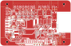
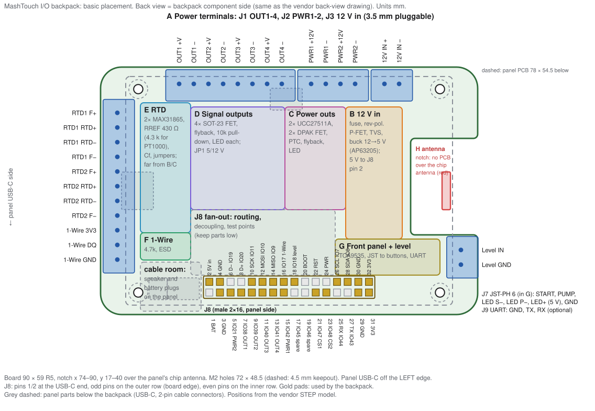

# I/O backpack: basic component layout

The placement of the MCU-less I/O backpack. What the backpack carries and why is in `docs/design.md` (section *I/O backpack PCB*); the GPIO allocation is in `src/board/pins.h`.

The parts as placed in KiCad (2026‑11‑17, not routed yet), exported from the board:

The first plan, drawn before the KiCad layout (zones only; where the two differ, the KiCad board and the *Zones* table below are current):

How the parts connect, on one page: [img/backpack-schematic.svg](img/backpack-schematic.svg) (the KiCad schematic, exported).

## Orientation and coordinates
- **Back view**, as in the vendor back-view drawing (`reference/waveshare/ESP32-S3-Touch-LCD-3.5.pdf`). This is also the backpack's component side, so the drawing needs no mirroring.
- Origin at the top-left corner of the board, x to the right, y down, in mm.
- The panel's USB‑C is off the **left** edge, its three side buttons along the **top**, the microSD slot top right, J8 along the **bottom**.
- **Sides:** all parts and terminals are on the side facing into the box (KiCad front, *F.Cu*). Only the J8 header sits on the side facing the panel (KiCad back, *B.Cu*), with its plastic body and mating pins towards the socket. Flipping the standard header footprint to the back would mirror its odd/even rows, so J8 uses a project footprint, `backpack:PinHeader_2x16_P2.54mm_Vertical_Bottom` (the standard one mirrored left to right), which comes out right when flipped. In the KiCad front view, pad 1 is at (25.95, 53.75), pad 2 directly above it, pad 3 to its right.
- The KiCad project is in `hardware/backpack/` (see its README).

## Measured from the vendor STEP model
`reference/waveshare/ESP32-S3-Touch-LCD-3_5.stp`, with the assembly placements applied. STEP axes map to the layout as x_layout = 45 + y_STEP and y_layout = 29.5 − x_STEP, with the panel's back side towards −z.

| What | Value |
|---|---|
| Panel PCB | 78.0 × 54.5 × 1.6 mm, centred on the holes: layout x 6–84, y 2.2–56.8 |
| Mounting holes | 4 **SMT M2 standoffs** on the panel's back, 4.0 mm tall, centres on 72.0 × 48.5 mm: layout (9, 5.25), (81, 5.25), (9, 53.75), (81, 53.75) |
| J8 socket | 5.1 mm tall, 41.2 mm long, **centred** between the holes (offset 0.01 mm). Outer row in line with the holes (layout y 53.75), inner row y 51.21, pins 1/2 at x 25.95 |
| Chip antenna | 9 × 2 × 1 mm part named `C3` (the schematic's CA‑C03), on the microSD-end edge, centred: **layout x 81.5–83.5, y 25–34** |
| Other back-side parts | 2‑pin 1.25 mm cable connectors 3.4 mm (one just left of J8, one under the top terminal strip), USB‑C 3.25 mm, 1 mm 2‑pin connector 3.15 mm, buttons and microSD ≤ 1.9 mm, everything else ≤ 1.3 mm |
| Camera module | 5.9 mm, under the middle of the backpack. Only on the -C version (not used); with one fitted, keep the backpack's back side flat there |

## Mechanics
| Item | Value |
|---|---|
| Outline | 90 × 59 mm, R5 corners, centred on the panel frame (92.44 × 61, R6), with a **notch at the right edge, x 74–90, y 17–40**, so there is no board over the antenna (6–8 mm clear of it) |
| Holes | 4× M2 (2.2 mm drill, 4.5 mm keepout) on the panel's standoffs |
| J8 | male 2×16 2.54 mm THT header with its body on the panel side, at the coordinates above |
| Terminals | 3.5 mm pluggable headers (Phoenix MC 1,5/…‑G‑3,5 or equivalent, 8 A). Each housing reaches about 3.2 mm past its outer pins, so blocks on one edge need a one-pitch gap between them |
| Stack gap | socket 5.1 mm + header body 2.5 mm = **7.6 mm** between the panel's back and the backpack. The header's mating pins must be **4.5 mm or shorter** (a standard 6 mm pin would bottom out in a 5.1 mm socket): use a short-pin header, or check the socket depth before choosing |
| Spacers | the panel's 4.0 mm standoffs + a **3.5 mm M2 spacer** on each, screws through the backpack. The header takes up the 0.1 mm |
| Clearance | at least 4.2 mm between the backpack and the tallest panel parts (3.4 mm connectors). Clip THT leads to 1.5 mm. About 3 mm above a plugged-in USB‑C plug under the left overhang |

## J8: what the backpack uses
Pin numbers from the Waveshare pinout image (see `docs/design.md`). Pin 1 is at the USB‑C end; odd pins are on the outer row.

| Pin | Net | Row | Backpack use | Zone |
|---|---|---|---|---|
| 1 | BAT | outer | not connected | |
| 2 | 5V (VBUS) | inner | 5 V from the buck, wide trace | Buck |
| 3, 4, 29, 30 | GND | both | ground | all |
| 5 | GPIO 21 | outer | PWR2 gate | C |
| 6, 8 | USB D−/D+ | inner | not connected | |
| 7, 9, 11, 13 | GPIO 38, 39, 40, 41 | outer | OUT1–OUT4 gates | D |
| 10, 12, 14 | GPIO 11, 10, 9 | inner | SPI SCK, MOSI, MISO to both MAX31865 | E |
| 15 | GPIO 42 | outer | PWR1 gate | C |
| 16 | GPIO 17 | inner | 1‑Wire DQ | F |
| 17, 19 | GPIO 45, 46 | outer | spare (strapping pins: output with pull-down only); test pads | |
| 18 | GPIO 18 | inner | level switch input | G |
| 20, 22, 24 | BOOT, RST, PWR | inner | not connected (optional test pads) | |
| 21, 23 | GPIO 47, 48 | outer | MAX31865 CS1, CS2 | E |
| 25, 27 | GPIO 44 RX, 43 TX | outer | UART debug header (optional) | G |
| 26, 28 | GPIO 7 SCL, 8 SDA | inner | TCA9535 (shared bus, no extra pull-ups unless the bus needs them) | G |
| 31, 32 | 3V3 | outer + inner | logic supply: MAX31865, TCA9535, 1‑Wire and level pull-ups | E, F, G |

## Zones
Terminals (pad centres, 3.5 mm pitch; KiCad reference in brackets):

| Edge | Block | Order |
|---|---|---|
| Top, pads at y 8.84 | **J1** OUT1–4, x 18.75–43.25 | OUT1 +V, OUT1 −, OUT2 +V, OUT2 −, OUT3 +V, OUT3 −, OUT4 +V, OUT4 − |
| | **J2** PWR1–2, x 50.25–60.75 | PWR1 +12V, PWR1 −, PWR2 +12V, PWR2 − |
| | **J3** 12 V in, x 67.75–71.25 | +12 V, GND |
| Left, pads at x 8.84 | **J4** RTD + 1‑Wire, y 10.9–45.9 | RTD1 F+, RTD+, RTD−, F−, RTD2 F+, RTD+, RTD−, F−, 1‑Wire 3V3, DQ, GND |
| Right tab below the notch, pads at x 81.16 | **J5** level, y 43.6–47.1 | IN, GND |
| Bottom right, pads at x 70.29 | **J7** JST‑PH 6, top entry (B6B‑PH‑K), to the buttons: the plug goes in from the box side, so it needs no room beside it. Pins y 56 (pin 1) up to 46 | START, PUMP, LED S−, LED P−, LED+ (5 V), GND |
| Below J8, pads at y 56.9 | **J9** UART (optional), x 61.51–56.43, each pin straight below its J8 pin (29, 27, 25) | GND, TX (GPIO 43), RX (GPIO 44) |

The terminal bodies reach from the board edge to about 2.4 mm inside the pads (y 11.2 on the top edge, x 11.2 on the left). Each position is named on the silkscreen just inside the body: `1+ 1- … 4-`, `P1+ … P2-`, `+12V GND`, `1F+ 1R+ 1R- 1F- 2F+ … 3V3 DQ GND` (reading upwards), `IN GND`, and `START PUMP LED S LED P +5V GND` beside J7. JP1 is marked `12V` / `5V` at its ends, JP2 and JP3 `3W` (1‑2) / `2/4W` (2‑3). Footprint references are only on the Fab layer.

Zones as placed in KiCad (layout coordinates):

| Zone | Where (mm) | Contents |
|---|---|---|
| **B** 12 V in | x 65–72.5, y 12.6–43.3, under J3 | F1 (mini blade holder) upright, input pads at the top under J3 pin 2; Q1 (reverse-polarity P‑MOSFET) below it with its tab next to F1's output pads; D1/R1 gate clamp under Q1; D2 (TVS) left of Q1's pins |
| **C** Power outputs | x 43.6–65.2, y 12.6–37, two 10.6 mm columns under J2 | per channel: SS34 flyback and DPAK MOSFET (tab up, towards the − terminal), gate pull-down and LED beside the MOSFET pins, 3 A PTC, UCC27511A with 10 Ω gate resistor, 100 k input pull-down and 1 µF, LED resistor |
| **D** Signal outputs | x 22.5–43.5, y 12.3–25.4, four 5.25 mm columns under J1 | per channel: AO3400A, B5819W flyback, gate resistor and 10 k pull-down, LED and its resistor. **JP1** below at y 28.4 |
| **E** RTD | x 11.5–23, y 11.5–37.6, next to J4 | U4/U5 (MAX31865) turned so the RTD pins face J4 and the SPI pins face down; 430 Ω reference above each, Cf between J4 and the chip, decoupling and CS pull-ups on the right, JP2/JP3 under each chip |
| **F** 1‑Wire | x 12–18, y 38–45, at J4's 1‑Wire pins | F4 (100 mA PTC), D16 (ESD), R27 (100 Ω), R28 (4.7 k); D3/R2 (5 V power LED) below |
| **Buck** 12 → 5 V | x 17.5–32, y 30.5–50, bottom left | C4 (100 µF bulk on +12 V) at the top, C5/C6 at the input, U1 (AP63205), L1, C7 (boot), C8/C9 at the output and C3 at J8 pin 2, so 5 V reaches the panel in a few mm. About 6 mm below U5 and JP3: keep the switch node (U1 pin 5, L1 pad 1) small |
| **G** Front panel | x 44–68, y 37–50, bottom middle-right | U6 (TCA9535) at x 51.8–60.2, I2C pins down above J8 pins 26/28; C19, Q8/Q9 and R33/R37 (LED ring drivers) right of it; button pull-ups, series resistors and ESD (R31/R32/R35/R36, D18/D19), C18 (level filter) and TP1 left of it; C1/C2 (3V3) above it; R34/R38 below J8 at x 64.9–67 |
| **Level** | x 74.3–78, y 41.6–45.8, next to J5 | R29 (pull-up), R30 (series), D17 (ESD); the filter cap C18 is next to J8 pin 18 |
| Test points | below J8, y 57.4 | TP2 5 V and TP4 GND under pins 1–4, TP5–TP8 (GPIO45, GPIO46, BOOT, RST) under pins 17–23; TP1 12 V at (48.5, 37.9), TP3 3V3 at (13.4, 50.4) |
| **H** Antenna | notch x 74–90, y 17–40 | no board; parts and copper pour stay at least 2 mm back from the notch |
| J8 fan-out | x 31–43.5, y 26–49 | kept free of parts for the gate, SPI and 1‑Wire traces |
| Free | top-right corner x 74.5–88.5, y 8–15 | nothing placed |

## Routing (done 2026‑11‑17)
The board is routed; DRC is clean. How it was done is in `tools/kicad/route/README.md`; the copper of both layers: [img/backpack-copper.svg](img/backpack-copper.svg). By hand (locked tracks): the 12 V input (3 mm), the 12 V trunk from Q1 on the back layer (3 mm, 2 mm after the PWR2 branch) up to the PTCs and on to the buck, the PWR1/PWR2 3 A paths (PTC → terminal on the back layer at 2 mm, MOSFET tab → terminal 2 mm, flyback diodes, three ground vias per MOSFET source, solid pour connection at the sources and at J3's GND pin), the buck's switching node, bootstrap, input and 5 V output, both MAX31865 front ends (RTD+/RTD−/FORCE− straight in on top, FORCE+ and FORCE2 to the jumpers on the back) and the level input. Every SMD ground pad has its own via into the pours. Everything else was autorouted by Freerouting. Clearance is 0.25 mm between tracks (0.2 mm among the front-panel signals around the TCA9535), 0.3 mm from the ground pour. Changes made for routing: C12/C15 turned so RTD+ and RTD− don't cross, L1 turned so its switch pad faces U1, C5/C3/D12/D14/R29/R30/D17 turned, R34 moved next to J7 pin 3.

The plan the routing followed:
- Output gates leave the outer row (pins 7–13, x 33.6–41.2) upwards through the free fan-out area. OUT3/OUT4 go nearly straight up into their columns; OUT1/OUT2 turn left along y 25.5–26.5, between the LED row and JP1. PWR1 (pin 15) goes up to U2 on the left of zone C.
- **PWR2's gate is J8 pin 5 (x 31), left of all the OUT gates**, but its driver U3 is on the right: route it on the back layer, under the fan-out, to U3.
- The SPI lines leave the inner row (pins 10–14) to the left towards E; the chip selects come from the outer row (21/23). Keep them away from the PWM traces of PWR1/PWR2.
- **12 V crosses the board** from Q1 (bottom right of B) to the buck (bottom left) and to JP1: about 1 A at most, a trace of 0.8 mm or more, on the back layer under zone G if needed. The power outputs take their 12 V from Q1 through zone C's PTCs: 2 mm or wider.
- 3 A paths (J2 → MOSFET tab, PTC → J2, MOSFET source → GND): short and 2 mm or wider, with vias into the ground pour at the source pins.
- 1‑Wire (16) runs left to F; level (18) runs right to J5 along the bottom; I2C (26/28) goes straight up into U6; UART (25/27) straight down into J9.
- Two layers: signals on top, a ground pour on the bottom and pour on the top where there is room. The buck's switching loop stays inside its zone; the RTD inputs stay on the left.

## Open checks
- Socket depth and the header's mating length (calipers on the real panel), then the spacer length.
- The second 2‑pin cable connector under the top terminal strip (layout x 40.5–48, y 5–10): which cable it is and where it leaves.
- Wi‑Fi range with the backpack fitted, in the closed box.
- J8 pin 1 with a meter on the first panel (see `docs/design.md`, *Checks on the first panel*).
